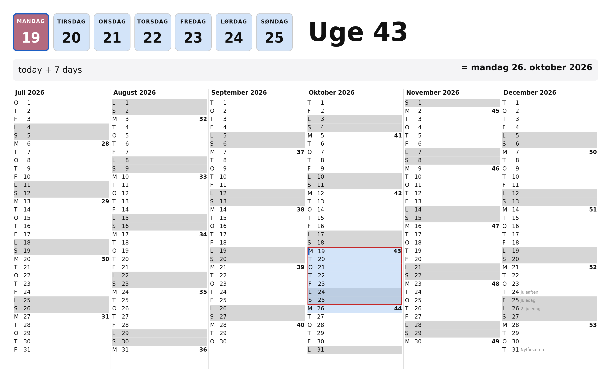

# glimt

A resident dashboard for Linux that appears on a key press, in the shape of Raycast:
one process that stays in memory with its window built, so showing it is a map rather
than a start.



It shows a calendar taken from [ugenr.dk] and a napkin calculator. The calendar is the
current week as seven coloured weekday boxes with its week number beside them, and a
half year laid out one month per column with ISO week numbers down the Mondays. The
calculator evaluates as you type, and a duration paints the days it covers.

## Keys

Two levels, told apart by whether anything has been typed.

| Key | While typing | Otherwise |
| --- | --- | --- |
| Escape | clear the input | dismiss the window |
| Ctrl+Q | clear it, return to today, dismiss | the same |
| Ctrl+V | paste from the clipboard | the same |
| up / down | move the selection a day | the same |
| Ctrl+up / down | move the selection a week | the same |
| anything printable | goes to the calculator | the same |

Neither key ends the process: the daemon stays resident, which is the point of it. It
exits on `glimtctl quit`.

## The calculator

```
2 + 3 * 4             14
13 usd in dkk         86,35 DKK
13 usd                86,35 DKK        kroner are the implied target
13 dkk                 1,74 EUR        kroner cannot be converted to kroner
today + 7 days        mandag 26. oktober 2026, and eight days painted on the grid
2026-10-19 + 30 days  onsdag 18. november 2026
2026-11-18 - 2026-10-19   30 dage, painted between the two
10.4.64.37/23        10.4.64.0 – 10.4.65.255, gateway 10.4.64.1
```

Whitespace is ignored, a comma is a decimal point, and words may be Danish or English.
Rates come from the European Central Bank's daily reference file, fetched at startup and
once a day, cached under `$XDG_CACHE_HOME/glimt/`, with a compiled-in table for the
first run and for being offline. An answer says which day's rates it used.

A CIDR range is shown as its first and last address. The gateway beside it is the second
address in the range, which is a common convention rather than something the prefix says:
a gateway is configured, and can be any address in the range.

Half a typed expression is not an error, and is never reported as one: the previous
answer stays, greyed, and nothing else happens. `13 u` is on its way to `13 usd`, so it
says nothing; `13 xyzzy` cannot become anything, so it says so, quietly, once.

The parser is Rust and the semantics are Scheme. `crates/napkin-math/src/prelude.scm`
holds the value model and the dispatch of the four operators across numbers, amounts,
dates and durations, which is where another kind of napkin calculation would go.

## The frontend

The dashboard is `crates/glimt`: GTK4 with Pango, GSK and a style sheet.

Everything below the drawing is shared: `glimt-cal` holds the calendar as data,
`napkin-math` the calculator, `glimt-shell` the daemon, the D-Bus service, the global
shortcut, the design tokens and the light and dark palettes, and `glimt-proto` the three
names a client needs. The frontend translates key events into that vocabulary and
renders the result.

By default the dashboard follows the session's light or dark preference through the
XDG settings portal, including the common case where the session is dark through its GTK
theme rather than through `color-scheme`. `--theme light` and `--theme dark` force a
palette; `--theme auto` is the default. While following the session, the palette is
reloaded in place, so switching while the daemon is resident repaints the window.

The comparison that led to GTK4 is kept as history in
[docs/graphics-stack-decision.md].

## What the environment decides

GNOME's mutter does not implement `wlr-layer-shell` and has not for six years, so on
this desktop no application can own an always-on-top, exactly-placed, keyboard-exclusive
window. What is left is an ordinary toplevel, maximized so it fills the work area and
leaves the top bar alone, and the floor on how fast one can appear is mutter's own map
path rather than the toolkit's.

Two consequences shape the dashboard:

- A window shown without an `xdg-activation-v1` token is refused focus and announced as
  a notification instead, so the shortcut comes from the GlobalShortcuts portal, whose
  `Activated` signal carries a token the compositor minted itself.
- Portability to a compositor that does have layer-shell is kept open through
  `gtk4-layer-shell`. `just nested` checks that under a nested wlroots compositor on its
  headless backend, without leaving GNOME and without taking the screen.

## Installing on NixOS

The flake exports a NixOS module that does the two things that are not obvious from the
outside: it keeps the daemon running for the life of the graphical session, and it binds
a key to it.

As an input:

```nix
glimt.url = "github:sshine/glimt";
glimt.inputs.nixpkgs.follows = "nixpkgs";
glimt.inputs.flake-parts.follows = "flake-parts";
glimt.inputs.import-tree.follows = "import-tree";
```

And in a module of your own:

```nix
{ inputs, ... }:
{
  flake.nixosModules.glimt = {
    imports = [ inputs.glimt.nixosModules.default ];

    services.glimt.enable = true;
  };
}
```

That installs `glimt` and `glimtctl`, runs the daemon as a user service bound to
`graphical-session.target`, and binds `<Super>Return` to `glimtctl toggle` through dconf.
Not Super+space: that is GNOME's own binding for switching input sources, and is already
taken on any machine with two keyboard layouts.

The daemon owns one session-bus name, and it is the first instance to claim it that keeps
it: an instance started while the service is running waits for the name instead of taking
it from under the resident one, and takes over when the service stops. That is why the
key keeps reaching the service, and why `systemctl --user stop glimt` is what to run
before `just dev` when the key should drive the development instance instead.
The options:

| Option | Default | |
| --- | --- | --- |
| `package` | `pkgs.glimt` | the dashboard to run |
| `shortcut` | `<Super>Return` | GNOME's notation; null leaves the keyboard alone |
| `months` | `6` | a count that divides the year aligns to its block |
| `theme` | `auto` | `auto` follows the desktop; `light` or `dark` forces one |
| `portal` | `false` | register the shortcut through the portal instead |
| `trigger` | `SUPER+Return` | what to ask the portal for, in its notation |
| `extraArgs` | `[ ]` | anything else for the daemon's command line |

**If the key does nothing**, check the daemon before the keybinding:

```sh
glimtctl show                 # "not activatable" when nothing is listening
systemctl --user status glimt
```

The service retries a name it cannot claim, and re-claims one it loses, for as long as it
runs, so a daemon that is up and still not answering is a bug rather than a thing to work
around. The other cause is the dconf list: GNOME keeps every custom keybinding in one
list. The module sets that list as a system default, and a user who has ever added a
custom shortcut through Settings has a list of their own in `~/.config/dconf/user` that
shadows it. Either add the binding by hand once, or set `services.glimt.portal = true`
and `shortcut = null`, which makes glimt register the shortcut itself through the
GlobalShortcuts portal. GNOME then asks once, in a dialog, and remembers. The portal is
also the only one of the two whose key press carries an activation token, which is what
mutter wants before it will hand a window the keyboard, so it is worth switching to if
the window comes up without focus.

The module is checked on every build: `nix build .#checks.<system>.module` evaluates a
system with it enabled and writes out the service command and the dconf keys, because
nothing else type-checks a module until someone rebuilds their machine.

## Releases

A tag publishes two kinds of artifact:

- `glimtctl-<tag>-{x86_64,aarch64}-unknown-linux-musl.tar.gz`: the client, statically
  linked against musl.
- `glimt-<tag>-x86_64.AppImage`: the dashboard as a single file for Linux machines
  without Nix. It carries its runtime closure, so it needs neither Nix nor a matching
  GTK or glibc on the host. It is about 110 MiB.

`just dist <tag>` builds both; `just appimage <tag>` builds only the AppImage. The
AppImage is still dynamically linked like any GTK application: "single file" means the
libraries, GIO modules, GSettings schemas and gdk-pixbuf loaders travel inside the
squashfs instead of being linked into the ELF. GTK's GStreamer media backend is disabled
for this build, which is most of the difference between 110 MiB and the 353 MiB the
default GTK closure produces.

The flake also exposes `glimt-bin` and `glimtctl-bin` for Nix users on other Linux
distributions who want the published artifacts instead of a source build. They pin the
same release in `nix/binary.nix`.

On NixOS, keep using the module above. The source build shares the system's GTK, fonts
and icon theme; an AppImage would carry a second copy of GTK and relies on the host's
font and icon directories being visible to it.

## Running it

```sh
nix develop          # or: direnv allow
just dev             # the dashboard, visible

just dev glimt --input "13 usd in dkk"   # with something already typed
```

As a daemon, which is how it is meant to run:

```sh
just daemon glimt   # registers SUPER+space through the portal
just toggle              # or drive it by hand
```

## Measuring

```sh
just bench 200
```

Each run starts the dashboard, waits for it, sits idle to measure what being resident
costs, then shows and hides it two hundred times. Latency is counted from the request
arriving to the compositor's own presentation timestamp, read from the frame clock.

[docs/graphics-stack-decision.md]: docs/graphics-stack-decision.md
[ugenr.dk]: https://www.ugenr.dk/
