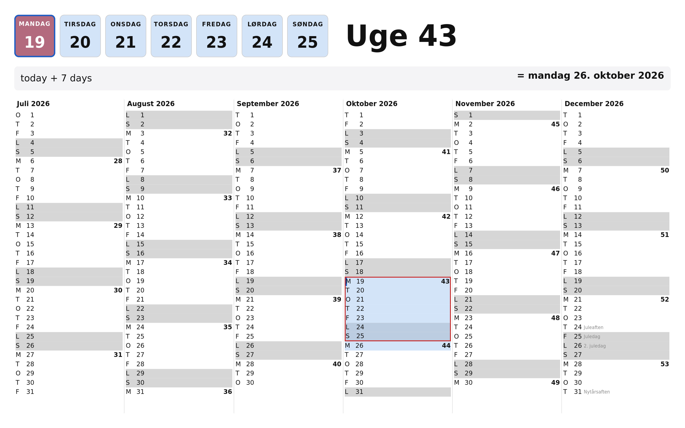
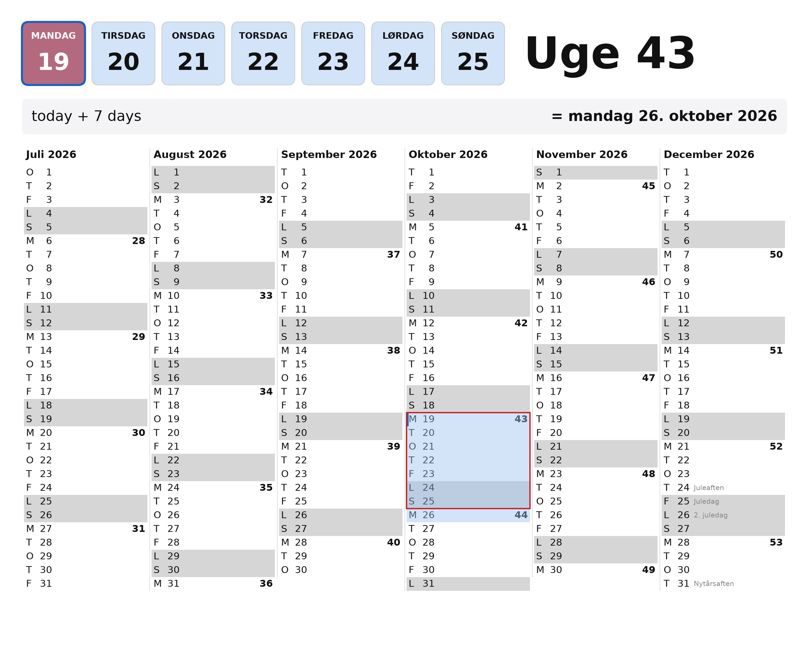

# Choosing the graphics stack

## The question

glimt is meant to behave like Raycast: one key press and the dashboard is there. That
rules out starting a process on demand, so the question is not which toolkit starts
fastest but which one can sit resident cheaply and put an already-built window on screen
without delay, while still drawing Danish text properly and being pleasant to grow a
graphical shell out of.

Two candidates were built, deliberately at opposite ends, both drawing the identical
calendar from `glimt-cal` and both driven by the identical daemon in `glimt-shell`:

- **A, `spike-gtk4`.** GTK4 through gtk4-rs. Pango shapes the text, GSK renders it, a
  style sheet carries the look, boxes do the layout.
- **B, `spike-raw`.** No toolkit. smithay-client-toolkit talks Wayland, tiny-skia paints
  into a shared-memory buffer, cosmic-text shapes the glyphs, and every rectangle is
  placed by arithmetic.

iced and egui were considered and dropped before any code: iced for API churn against a
tool meant to last, egui for weak text layout and fiddly pixel-exact grids.

## What the environment decided before the toolkits did

Measured on the machine this is for: GNOME Shell 50.4, Wayland, mutter, Mesa.

Mutter does not implement `wlr-layer-shell`. [GNOME/mutter#973][issue] has been open
since 2020 and was still open when this was written. Every other major compositor
implements it. The consequences fall on both candidates equally:

- No application on this desktop can own an always-on-top, exactly-placed,
  keyboard-exclusive window. What is available is an ordinary `xdg_toplevel`, either
  undecorated and placed by mutter, or fullscreen with a translucent backdrop so the
  dashboard can be placed inside a surface it does own.
- A window shown without an `xdg-activation-v1` token is refused focus by
  focus-stealing prevention and announced as a notification. GNOME gives an application
  no way to grab a key, and a command bound to a GNOME custom shortcut is spawned
  without focus, so it has no token to pass on.
- `org.freedesktop.portal.GlobalShortcuts` is present on this session and solves both
  halves: the compositor observes the key, and its `Activated` signal carries a token
  the compositor minted itself and will therefore honour.
- Mutter's map path and its window-open animation set the floor on how quickly anything
  can appear. The toolkits are measured against that floor, and the gap between them
  may be small next to it.

## How the measurement works

Latency is counted from the D-Bus request arriving in the daemon to the compositor's
own presentation timestamp. Both candidates report against CLOCK_MONOTONIC in
microseconds, so the two numbers mean the same thing:

- A reads `GdkFrameTimings::presentation_time()`, which is `g_get_monotonic_time`.
- B reads `wp_presentation`, which mutter implements and which no toolkit exposes.
  Being unable to reach it is why winit was dropped from this candidate before it was
  written.

Resident cost is reported as both RSS and PSS. RSS alone would punish A unfairly: its
libraries are already mapped into the GNOME session, so much of what RSS attributes to
the process is shared with programs that would be running regardless.

Reproduce with:

```sh
just bench-all 200
just compare
```

## Results, first round

Taken against the first version: a fixed 1180x960 window showing only the calendar. One
GNOME session, one machine, 100 shows each, release builds, an output at scale 2 so
every surface is 2360x1920. Rerun before reading much into a millisecond.

| | A, GTK4 | B, raw |
| --- | --- | --- |
| show latency p50 | 60.0 ms | 35.6 ms |
| show latency p95 | 70.8 ms | 48.3 ms |
| show latency p99 | 74.4 ms | 54.9 ms |
| show latency min / max | 45.3 / 79.2 ms | 18.9 / 58.6 ms |
| cold start | 155 ms | 61 ms |
| idle RSS | 48 MiB | 9 MiB |
| idle PSS | 40 MiB | 8 MiB |
| idle CPU | under the 10 ms tick | under the 10 ms tick |
| binary | 5.7 MiB | 10.5 MiB |
| Nix closure | 887 MiB, 266 paths | 82 MiB, 27 paths |
| full repaint at 2x | not instrumented | 92 ms |

Reading them:

- **B is faster to appear, by about 24 ms at the median.** Both are above one frame at
  60 Hz, so neither is instant; the gap is real but it is the difference between two and
  four frames, not between fast and slow. Two causes are plausible and neither was
  isolated: GTK schedules its drawing through the frame clock, which costs up to a frame
  before anything is painted, and GTK unrealizes a hidden window, which throws away the
  GSK renderer and builds it again on the next show. B keeps its painted buffer across a
  hide and a show is an attach of bytes that are already correct.
- **B costs a fifth of the memory.** 8 MiB against 40 MiB of PSS. RSS flatters A less
  than expected: much of GTK is already mapped into the session, but 40 MiB is still
  what this process adds.
- **The binaries go one way and the closures the other.** A links GTK from the system
  and is 5.7 MiB; B carries tiny-skia, cosmic-text and a font database and is 10.5 MiB.
  Packaged, A pulls 887 MiB over 266 store paths against B.s 82 MiB over 27. On a GNOME
  machine the marginal cost of A.s closure is close to nothing, because the session has
  already paid for GTK; anywhere else it is the whole of it.
- **Idle cost is the same, which is to say none.** Both sit under the kernel's 10 ms
  accounting tick over 25 seconds. The first measurement said otherwise for B and was
  wrong: the loop was polling on a 50 ms timeout, which is a property of the loop and
  not of the stack.
- **B's full repaint is the number that does not appear in any show.** 92 ms to paint
  2360x1920 with tiny-skia and cosmic-text, on the CPU, scaling with pixel count. It
  never enters the measured path because the calendar does not change between one key
  press and the next. It would enter the path of anything that redraws while the user
  types.

## What the numbers cannot say

Both candidates write a PNG of exactly what they draw, so the comparison of the drawing
is on pixels rather than on a compositor screenshot:

```sh
cargo run --release -p spike-gtk4 -- --no-portal --screenshot docs/img/spike-gtk4.png
cargo run --release -p spike-raw  -- --no-portal --screenshot docs/img/spike-raw.png
```





- **Text.** Both set the Danish line under the week number correctly, ø and å included,
  from the same fontconfig family. Pango and cosmic-text differ in spacing and in how
  heavily they hint, visibly but not in anyone's favour.
- **Theming.** A inherits the session's theme under its own style sheet. The session
  here is dark, and the first capture came out dark text on a dark background because
  the backdrop had been set on the window rather than on a widget this project owns. B
  cannot inherit anything, which is a cost in a light session and a saving in this one.
- **Layout.** A's columns came out touching until the rows were given the same inset B
  computes. Boxes and a style sheet remove the arithmetic, not the need to be exact.
- **Focus.** Both took keyboard focus on every show in this run, with no "Window is
  ready" notification, including without an activation token. That is mutter's policy
  rather than a promise, and the portal path exists so it does not have to be relied on.
- **Length.** The drawing is 474 lines of widget tree and style sheet for A against 819
  of arithmetic, text handling and damage tracking for B, and the gap widens with every
  feature: it was 235 against 440 when the calendar was all there was. The difference is
  the layout engine, the text layer, and working out which pixels changed.
- **Portability.** Both work under a nested sway on the headless wlroots backend, A
  through gtk4-layer-shell and B through its own layer surface, so either could move to
  niri, Hyprland, sway or COSMIC. It took running there to find that B was reattaching a
  buffer the compositor had not released: mutter happened to free it in time and sway
  did not. A toolkit would not have let that bug exist.
- **Growing into a shell.** A fuzzy-search list, scrolling and a text entry are the next
  things this needs. A has them. B would have to grow them, and every one of them
  redraws while the user types, which is where its 92 ms repaint stops being free.

## What the second iteration changed

The first measurements were taken against a fixed 1180x960 window showing a calendar and
nothing else. The application has since grown the things it was always going to grow: it
is maximized, it takes the keyboard, and it carries a calculator that evaluates on every
keystroke and paints its answer onto the grid. Everything above was measured again
against that, 60 shows each on one session.

| | A, GTK4 | B, raw | was, A | was, B |
| --- | --- | --- | --- | --- |
| show latency p50 | 45.6 ms | 47.6 ms | 60.0 | 35.6 |
| show latency p95 | 58.2 ms | 63.5 ms | 70.8 | 48.3 |
| show latency p99 | 69.2 ms | 73.3 ms | 74.4 | 54.9 |
| cold start | 315 ms | 271 ms | 155 | 61 |
| idle RSS | 61 MiB | 94 MiB | 48 | 9 |
| idle PSS | 57 MiB | 81 MiB | 40 | 8 |
| binary | 18.7 MiB | 23.5 MiB | 5.7 | 10.5 |
| per keystroke | not instrumented | 0,5-1,6 ms | | |

Three of those are worth reading carefully.

**The latency gap closed.** B led by 24 ms at the median and now leads by nothing: the
two are within noise of each other, and A improved while B got worse. Maximizing is the
likely cause on both sides. A is mapped at the size it will keep, so the configure it
used to pay for no longer moves anything; B has four times the pixels to hand over.
Whatever the mechanism, the number that drove the first decision is gone.

**B's memory advantage inverted.** It held a fifth of A's resident size and now holds
half again as much. B keeps the picture in main memory: the work pixmap, the cached grid
behind it and the shared-memory buffer the compositor reads are each 3072x1856x4, which
is 23 MiB apiece and 68 MiB between them. A keeps its picture in GPU textures that do
not count against it. That is not a cost B can tune away; it is what painting on the CPU
means at this size.

**The calculator costs both of them the same 60 ms of cold start** to build the Scheme
runtime and compile the prelude, and roughly 13 MiB of binary for cranelift. It is paid
once at daemon start, on no path anyone waits on, and it is the same figure on both
sides, so it changes the comparison not at all.

**What a keystroke costs is where they still differ, and the first answer here was
wrong.** It said 10.5 ms, measured around the part of B's redraw that copies the cached
grid and paints over it. That left out the rest of the path: a fresh shared-memory
buffer per frame, a per-pixel channel swap over the whole 23 MiB surface, and a
`damage_buffer` covering all of it, which made the compositor recomposite and re-upload
the entire window for one character in a text field. Typing was visibly slow, and the
number had not been taken over the thing that was slow.

B now tracks damage. It keeps the painted picture in one pixmap, diffs each new calendar
against the last to find the regions that actually differ, restores only those from the
cached grid, repaints only the overlay items that intersect them, copies only those into
the buffer, and reports only those to the compositor. Typing touches one region, the
52-pixel calculator band, in 0.5 to 1.6 ms. Moving the selection touches three: the week
strip and the two rows whose marks changed, in 2.0 ms. The grid itself is repainted when
the six months change and at no other time.

Making that correct also needed two buffers. One is not enough: the compositor is still
reading the buffer just attached when the next key arrives, so every frame was taking the
"allocate a new one and repaint it in full" path, which is the path that was being
measured as fast. Each buffer now carries the regions in which it has fallen behind the
painted picture, because the one being written to is a frame older than the other.

That is a `Region` type, a diff between successive calendars, per-buffer bookkeeping, and
region-restricted versions of the copy, the swap and every drawing call: about 150 lines
whose entire purpose is working out which pixels changed. GTK does it from the widget
tree without being asked, which is why A's keystroke was never instrumented. There was
nothing to instrument.

## Decision

Take **A, GTK4**.

This was already the recommendation on the first round, when B won every measurement and
the argument for A rested entirely on what the application would become. The application
has since become a little of it, and B's measurements went with it: the latency lead is
gone, the memory lead is inverted, and the one number B still owns is a binary size
nobody is counting. What is left is the argument that was there before, now with
evidence under it. A fuzzy-search list, a scrolling pane and a text entry are next, and
each one is another 10 ms on B's keystroke and another hand-built widget.

`crates/spike-raw` stays, for as long as both are wanted. It earns its place twice over:
it is the control that says what the compositor's own floor is, so a later regression in
A can be told apart from a change in mutter, and it is the only one of the two that can
take a layer surface without a C library in the way.
